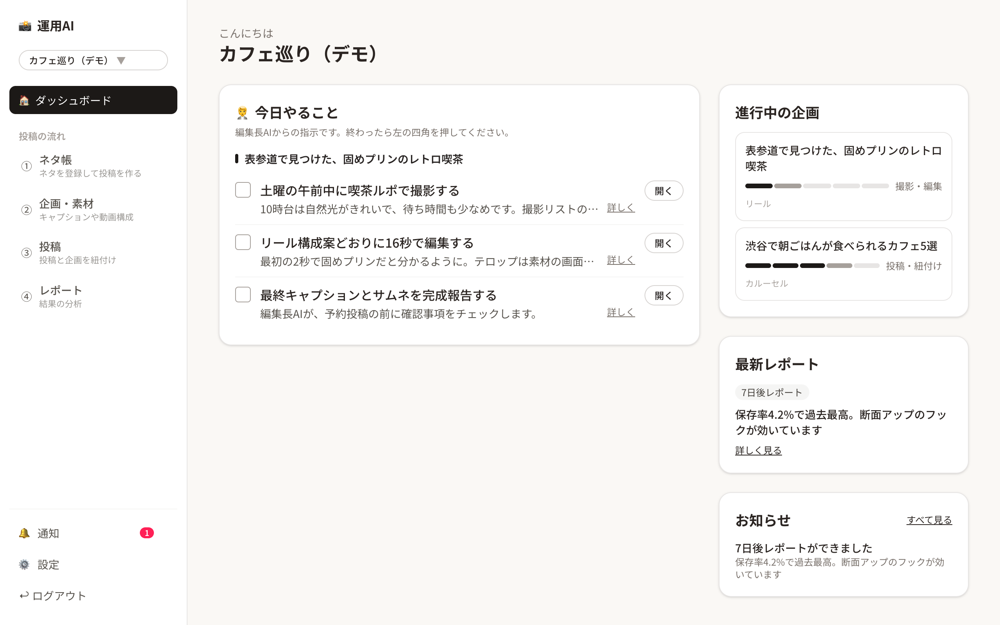
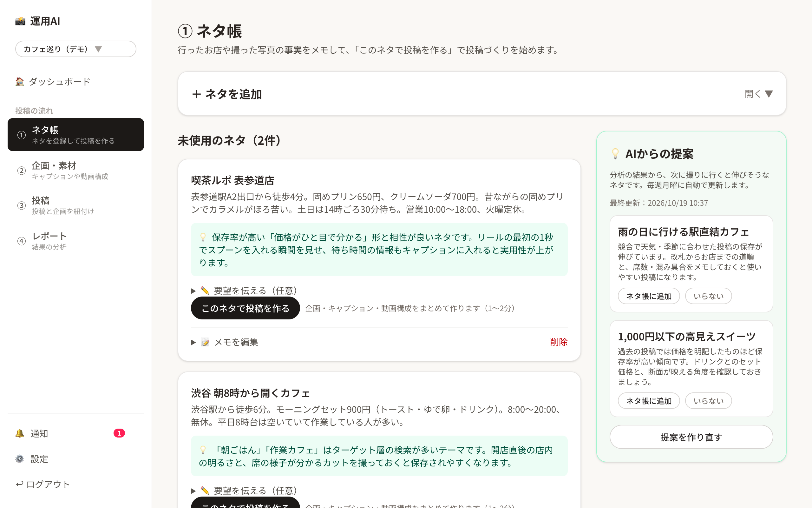
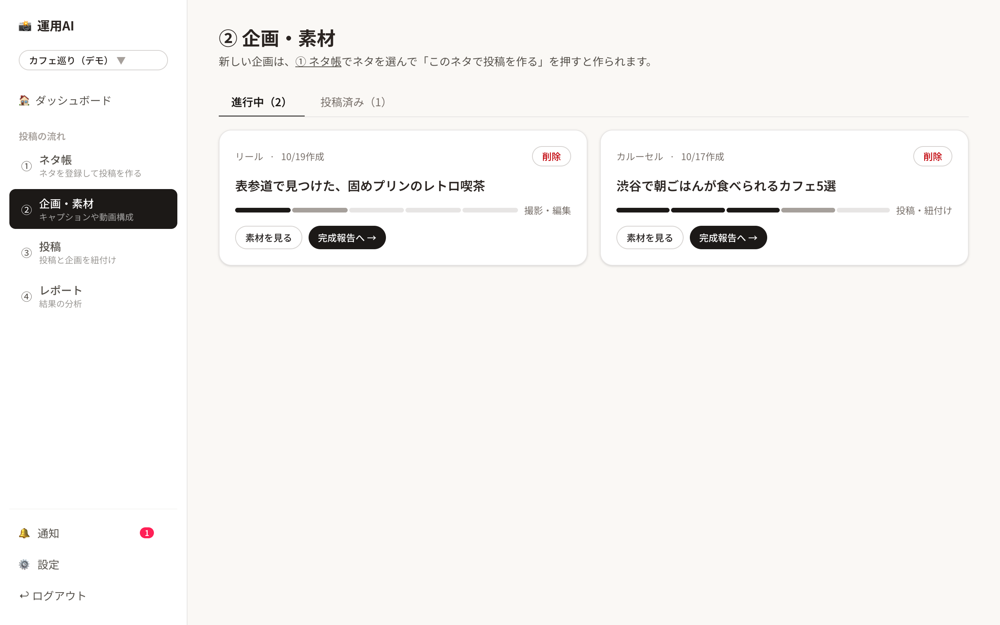
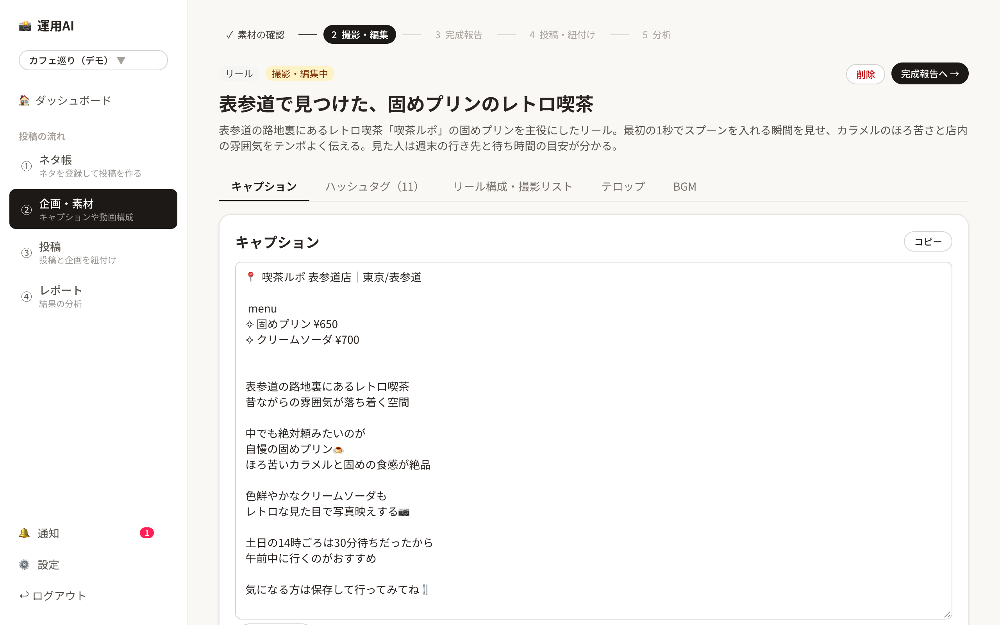
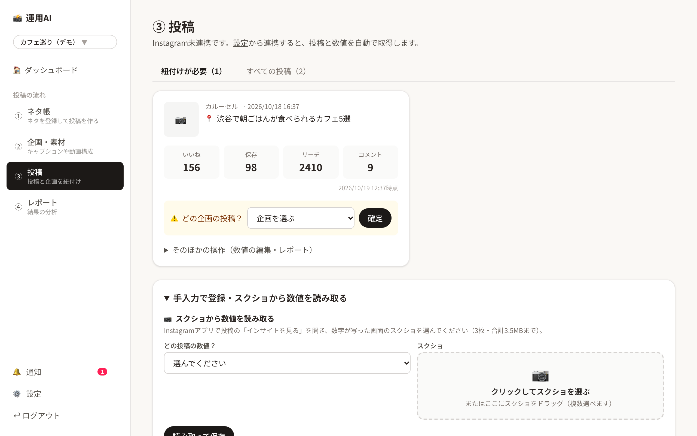
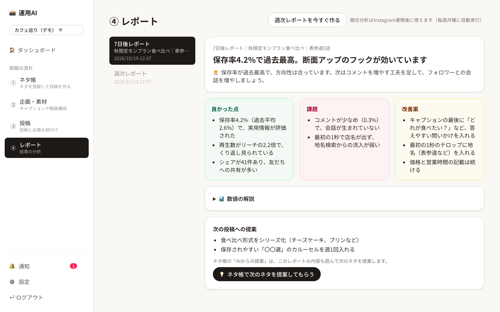
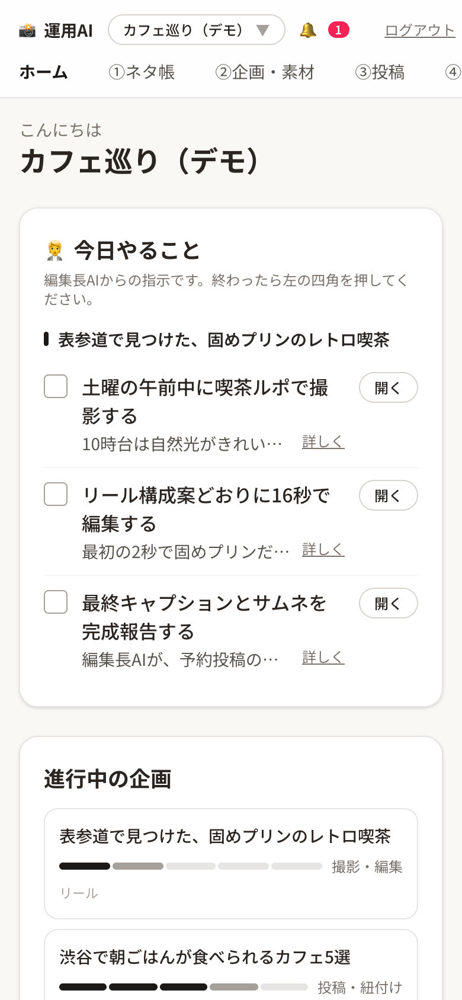

# 📸 Instagram運用AI

役割を分けた **5つのAIエージェント（編集長・企画・投稿作成・動画構成・分析）** が、Instagram運用の「考える作業」を引き受けるWebアプリです。
人間は **お店に行ってネタを集め、撮影・編集・投稿** することに集中し、「ネタ → 素材作成 → 投稿 → 分析 → 次のネタの提案」のサイクルを毎回データに基づいて回せます。

> 個人のグルメアカウント・旅行vlogアカウントの運用のために開発しています。

## スクリーンショット

| ダッシュボード | ① ネタ帳 |
| --- | --- |
|  |  |
| 編集長AIの「今日やること」を企画ごとに表示。進行中の企画は進み具合のバーで分かる | 行ったお店の事実をメモし、「このネタで投稿を作る」で投稿づくりを開始。分析をもとにAIが次のネタとアドバイスを提案 |

| ② 企画一覧 | ② 投稿素材 |
| --- | --- |
|  |  |
| 進行中・投稿済みをタブで分け、段階ごとの次の操作へ進める | キャプション・ハッシュタグ・リール構成・テロップ・BGMをタブで切り替え。編集・再生成・コピーが可能 |

| ③ 投稿 | ④ 分析レポート |
| --- | --- |
|  |  |
| Instagramから取得した投稿の数値を表示し、企画との紐付けを確定 | 投稿7日後・毎週、分析AIと編集長AIが「良かった点・課題・改善案」をまとめる |

<p align="center">
  <br>
  スマホにも対応
</p>

※ スクリーンショットは架空のデモデータです。

## 主な機能

| 機能 | 内容 |
| --- | --- |
| AIヒアリング | チャットでターゲット・地域・世界観などを聞き取り、「アカウント方針」として保存。すべてのAIがこの方針に沿って動く |
| ネタ帳から投稿づくり | 行ったお店・撮った写真・感想を「ネタ」として登録。ネタを選ぶと、企画AIが分析の結果も読んで企画を作り、そのまま投稿素材まで作成 |
| AIからの提案 | 競合分析と投稿レポートをもとに、次に撮りに行くと伸びそうなネタと、登録したネタへのアドバイスを提案（毎週月曜に自動更新） |
| 投稿素材の生成 | ジャンル別のテンプレートに沿ったキャプション、ハッシュタグ（大・中・小規模）、BGM候補（Instagram内音源／著作権フリーを区別）、秒単位のリール構成、撮影リスト、テロップ |
| 完成報告チェック | 最終キャプションとサムネ画像を送ると、編集長AIが画像も見て企画との整合をチェック |
| Instagram連携 | 投稿・インサイトを毎日自動取得。新しい投稿を完成報告のキャプションと照合して、企画との紐付け候補を提示 |
| 競合分析 | 競合アカウントの投稿を種類別に集計し、ジャンルに有効な投稿種類と頻度を分析 |
| 自動レポート | 投稿7日後と毎週月曜にレポートを自動作成し、アプリ内とメールで通知（週次は、数字がそろった投稿7〜14日後のものを比較） |
| スクショ読み取り | Instagram連携が使えない時の保険として、インサイト画面のスクショから数値を読み取る |
| 複数アカウント | 1つのログインで、ジャンルの違う複数アカウントを切り替えて運用 |

## 技術スタック

| 用途 | 技術 |
| --- | --- |
| フロントエンド・サーバー | [Next.js 16](https://nextjs.org/)（App Router・Server Actions）、React 19、TypeScript |
| スタイリング | Tailwind CSS v4 |
| 認証・DB・ファイル保存 | [Supabase](https://supabase.com/)（Google ログイン、PostgreSQL、行レベルセキュリティ、Storage） |
| AI | [Gemini API](https://ai.google.dev/)（`@google/genai`。構造化出力・画像読み取り） |
| SNSデータ | Instagram API with Facebook Login（Graph API v25.0、Business Discovery） |
| メール通知 | [Resend](https://resend.com/) |
| ホスティング・定期実行 | [Vercel](https://vercel.com/)（Hobby、Cron Jobs） |

### 設計のポイント

- **AIエージェントは「役割ごとのプロンプトを持つ関数」** として実装し、編集長AIが順に呼び出す構成（[`src/lib/agents/`](src/lib/agents)、[`src/lib/workflows.ts`](src/lib/workflows.ts)）
- **プロンプトはコードから分離**：[`prompts/`](prompts) のMarkdownを編集するだけでAIの振る舞いを調整できる
- **構造化出力**：Geminiの JSON Schema 指定で、AIの出力をそのまま画面とDBで扱える形にしている
- **マルチユーザー前提のデータ設計**：全テーブルに `user_id` を持たせ、RLSで本人のデータだけ読み書きできるようにしている
- **秘密情報はサーバー側だけ**：InstagramのトークンはAES-256-GCMで暗号化して保存し、ブラウザに出さない
- **止まりにくくする工夫**：AIの混雑時は自動リトライ＋軽量モデルへの切り替え、定期実行の失敗は記録して翌日に再実行
- **想像で書かせない**：ネタ帳に書いた事実だけをもとにキャプションを作り、分からない情報は【要確認】として残す

### AIエージェントと運用サイクル

```
                ┌──────────── 編集長AI（司令塔） ────────────┐
                │                                              │
 【人間がネタ帳に登録】 → 企画AI → 投稿作成AI ＋ 動画構成AI
                                              ↓
                          【人間が撮影・編集】 → 完成報告 → 編集長AIがチェック
                                              ↓
                          【人間がInstagramで投稿】 → 自動取得・紐付け
                                              ↓
                          分析AI（7日後・週次） → 編集長AIが改善案に
                                              ↓
                          企画AIが次のネタを提案 → ネタ帳へ
```

## フォルダ構成（主なもの）

```
prompts/                  … 各AIエージェントへの指示文
supabase/migrations/      … DBのテーブル定義（SupabaseのSQL Editorで順に実行）
src/proxy.ts              … 全ページ共通のログイン判定
src/lib/agents/           … AIエージェントの関数
src/lib/workflows.ts      … 運用サイクル（編集長AIが各AIを順に呼ぶ処理）
src/lib/instagram/        … Instagram API・データ同期・競合分析・自動レポート
src/app/(main)/           … ログイン後の画面
src/app/api/cron/daily/   … 毎朝の定期実行
```

## ローカルで動かす

1. Supabaseでプロジェクトを作り、`supabase/migrations/` のSQLを `0001` から順にSQL Editorで実行
2. SupabaseでGoogleログインを有効にする（Google CloudでOAuthクライアントを作成）
3. [Google AI Studio](https://aistudio.google.com/apikey) でGemini APIキーを発行
4. 環境変数を設定して起動

```bash
cp .env.example .env.local   # 値を入れる（各項目の説明はファイル内のコメント参照）
npm install
npm run dev                  # → http://localhost:3000
```

Instagram連携には、Meta for Developersで「ビジネス」タイプのアプリを作り、ビジネス向けFacebookログインの設定（configuration）を作成する必要があります。Instagramはプロアカウントで、Facebookページとリンクしている必要があります。
